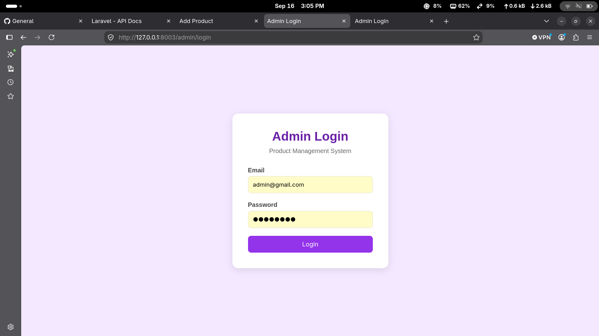
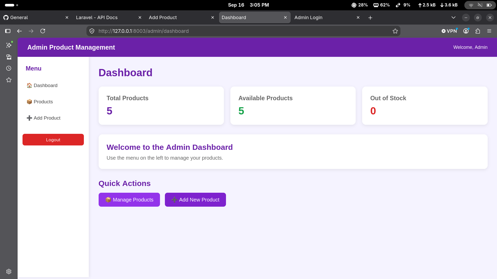
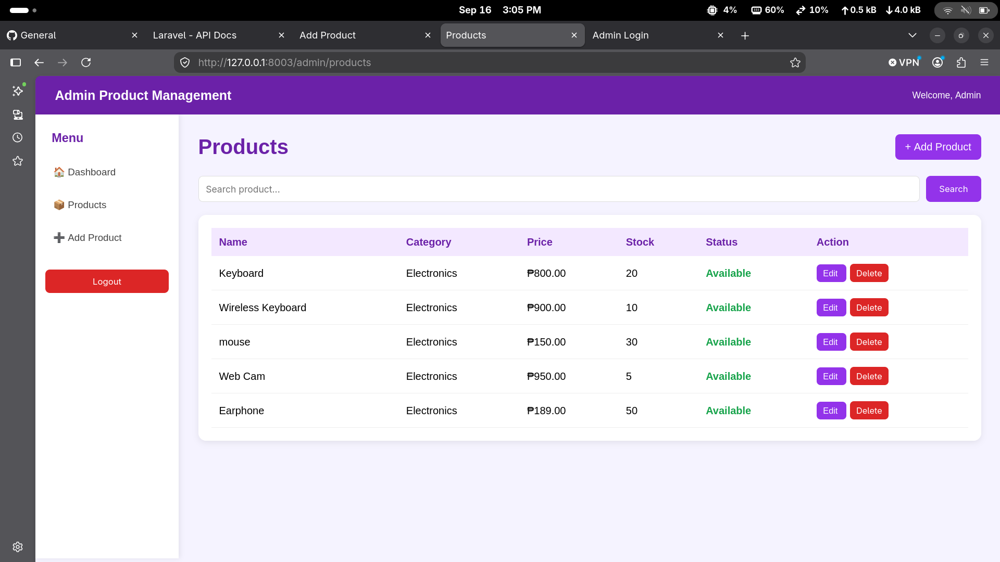
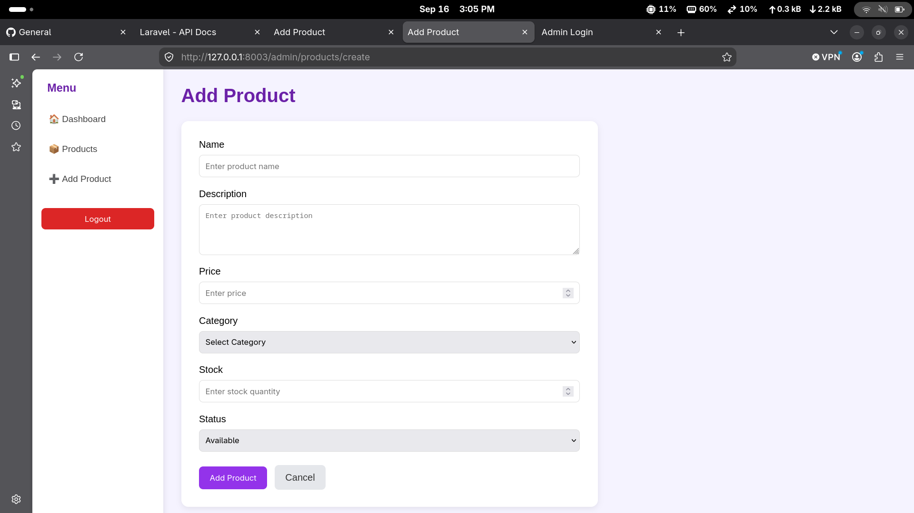

# Admin Product Management System

A simple **Admin Product Management System** developed using Laravel. The system allows an administrator to log in and manage products through a simple admin dashboard.

The project uses **MongoDB** as the database and follows the **MVC (Model-View-Controller)** structure of Laravel.

## Technologies Used

* Laravel 13
* PHP
* MongoDB
* HTML
* CSS
* JavaScript
* Blade Templates

## Features

* Admin Login
* Admin Dashboard
* Product Management
* Add Product
* View Products
* Search Products
* Edit Product
* Delete Product
* Product Stock Management
* Product Status
* MongoDB Database
* Admin Authentication

## System Screenshots

### 1. Admin Login

The login page allows the administrator to access the system.



### 2. Admin Dashboard

The dashboard displays the total number of products, available products, and out-of-stock products.



### 3. Product Management

The Products page displays the products stored in the system. It also includes search, edit, and delete functions.



### 4. Add Product

The Add Product page allows the administrator to enter product information such as name, description, price, category, stock, and status.



## Database

The system uses **MongoDB** to store administrator and product information.

Each product contains:

* Product Name
* Description
* Price
* Category
* Stock
* Status

## Project Structure

The project follows the Laravel MVC structure:

```text
app/
├── Http/
│   ├── Controllers/
│   └── Middleware/
│
├── Models/
│
resources/
└── views/
    ├── admin/
    ├── auth/
    └── layouts/

routes/
├── web.php
└── api.php

screenshots/
├── Screenshot_1.png
├── Screenshot_2.png
├── Screenshot_3.png
└── Screenshot_4.png
```

## Purpose

This project was created as a school project to demonstrate the use of **Laravel, MongoDB, MVC architecture, authentication, and CRUD operations**.


## System Screenshots

### 1. Admin Login

The login page allows the administrator to access the system.


### 2. Admin Dashboard

The dashboard displays the total number of products, available products, and out-of-stock products.


### 3. Product Management

The Products page displays the products stored in the system. It also includes search, edit, and delete functions.


### 4. Add Product

The Add Product page allows the administrator to enter product information such as name, description, price, category, stock, and status.


